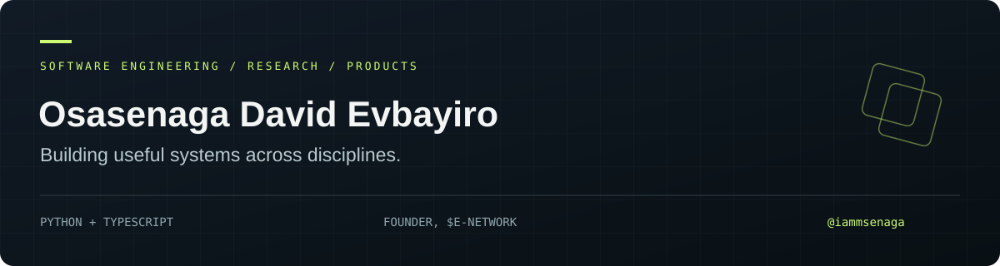

  

  <a href="https://senagadavid.netlify.app/">Portfolio</a> ·
  <a href="https://github.com/iammsenaga/engineering-portfolio">Project case studies</a> ·
  <a href="https://ng.linkedin.com/in/osasenaga-evbayiro-4a7885395">LinkedIn</a> ·
  <a href="mailto:senaga.tech.hub@gmail.com">Email</a>

### I build software around problems I understand.

I'm **Dr. Osasenaga David Evbayiro**, a software engineer, researcher, veterinarian and founder of **$E-Network**, based in Nigeria. My work spans clinical software, election systems, commerce and tools for research.

I work across product architecture, Python backends and React/TypeScript interfaces. My clinical and research background shapes how I approach data, explain decisions and design software for the people using it.

**Open to senior software engineering opportunities.**

### Selected work

| Project | What I built | Explore |
| :--- | :--- | :--- |
| **VPRS** | A veterinary patient record and intelligence platform, connecting clinical workflows, decision support and reporting. | [Case study](https://github.com/iammsenaga/engineering-portfolio/blob/main/projects/vprs.md) |
| **SEV** | An election platform covering accreditation, candidate screening, voting and public results. | [Case study](https://github.com/iammsenaga/engineering-portfolio/blob/main/projects/sev.md) · [Website](https://sevs.netlify.app/) |
| **MealsByMoon** | A food commerce and catering website with menu discovery, customer accounts and ordering workflows. | [Case study](https://github.com/iammsenaga/engineering-portfolio/blob/main/projects/mealsbymoon.md) · [Website](https://mealsbymoon.co.uk/) |
| **Personal portfolio** | A React/TypeScript portfolio with project narratives, interactive demonstrations and a publishing workspace. | [Case study](https://github.com/iammsenaga/engineering-portfolio/blob/main/projects/personal-portfolio.md) · [Website](https://senagadavid.netlify.app/) |
| **PwetyPawcher Counter** | A browser tool for random sampling with replacement, saved samples and local history. | [Source & guide](https://github.com/iammsenaga/pwetypawcher) |

Commercial project source code remains private. The case studies describe my role, the product and engineering considerations without exposing proprietary implementations.

### Technologies I use

**Languages:** Python · TypeScript · JavaScript · SQL  
**Application development:** React · Flask · Vite · HTML/CSS  
**Data & intelligence:** MySQL · SQLite · NumPy · FAISS · MediaPipe  
**Delivery:** Git · GitHub Actions · Netlify

### Research & open source

I created the **Evbayiro RRR-First Method** and maintain its Python implementation, [evbayiro-irr](https://github.com/iammsenaga/evbayiro-irr). My wider research connects clinical science, computation and numerical methods.

---

[Explore my work](https://senagadavid.netlify.app/) · [Discuss a role or project](mailto:senaga.tech.hub@gmail.com)
